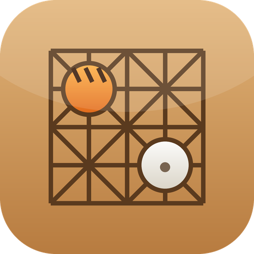

# Bagh-Chal (बाघ चाल) 🐯🐐

**Nepal's centuries-old board game of tigers and goats**, on a warm wooden board. No ads, no account, works offline.

* **Play the goats** against the computer: trap all four tigers before they eat five goats.
* **Play the tigers**: capture five goats before you're trapped.
* **Two players**: pass the phone.
* **Computer opponent** at three levels:
  * *Easy* makes mistakes on purpose.
  * *Medium* thinks 3 moves ahead.
  * *Hard* thinks up to 5 moves ahead, using minimax with alpha-beta search.
* Moves glide, captured goats fade away, and a vibration marks every capture.
* Tap a piece to see where it can go; red rings show captures.
* **💡 Hint**, **↶ Undo** and **📜 How to play**.
* **Your record**: wins and losses as goats and as tigers.

## Rules
* The board has 25 points. Pieces move along the lines to a neighbouring empty point.
* 4 tigers start in the corners. There are 20 goats, and goats move first.
* Goats are placed one per turn. They can only move once all 20 are on the board.
* A tiger captures by jumping over a goat in a straight line to the empty point behind it.
* 🐯 The tigers win with 5 captures. 🐐 The goats win when no tiger can move.
